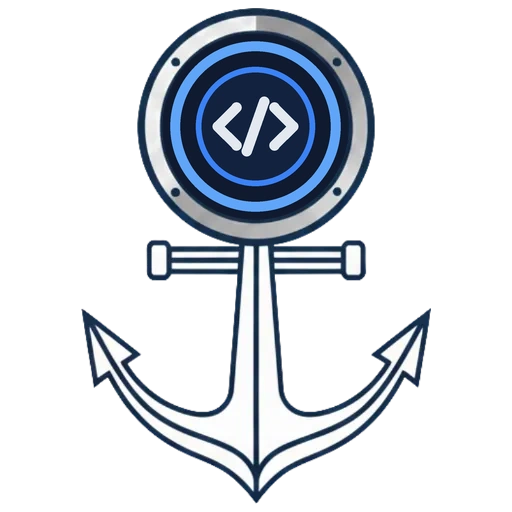

# Porthole ⚓️



> Centralized dashboard for running Docker containers with automatic endpoint discovery.


Porthole serves as the ultimate shortcut page for your self-hosted Docker environment, automatically detecting running applications, their published ports, and Traefik URLs. It centralizes all your services into one beautiful dashboard, ensuring you never have to memorize a port number again.

It resolves container icons automatically 

## Features

- 🕵️‍♂️ **Auto-Discovery**: Lists running containers with published-port or Traefik endpoints, including services without published ports.
- 🎨 **Automated Icons**: Maps container image names to icons using [Dashboard Icons](https://github.com/homarr-labs/dashboard-icons).
- 🔄 **Update Detection**: Checks Docker Hub and public GitHub Container Registry images for newer versions and digest changes.
- 🖥️ **Multiple Docker Hosts**: Fetches configured Docker connections together and separates hosts and Compose projects in the dashboard.
- ⚙️ **Per-Container Settings**: Choose a service URL and configure update checking for each container.
- 🚦 **Status Indicators**: Shows container health with color-coded semaphore (green/yellow/red).
- 🐳 **Docker Native**: Runs as a single, lightweight Docker container.
- 🛠 **Customizable**: Override icon mappings via a simple YAML configuration.

## Service URLs

Porthole discovers full URLs from Docker published ports and literal Traefik HTTP router labels. Clicking a tile prefers Traefik; when several Traefik URLs exist, a unique root route wins. Ambiguous choices open settings. A saved URL choice takes precedence and is remembered by endpoint ID.

The gear icon groups candidates under **Traefik URLs**, **Published Ports**, and any additional provider sections. Published ports use each connection’s `published-host`; connections fall back to `127.0.0.1` when `published-host` is omitted. See [endpoint configuration and rule support](docs/CONFIGURATION.md#endpoint-discovery).

## Quick Start

### Docker run — one host

Replace `docker.example.com` with your Docker host's IP address or hostname:

```bash
docker run -d \
  -p 9753:9753 \
  -v /var/run/docker.sock:/var/run/docker.sock \
  -e PORTHOLE_DOCKER_CONNECTIONS_0_ID=local \
  -e PORTHOLE_DOCKER_CONNECTIONS_0_NAME=Local \
  -e PORTHOLE_DOCKER_CONNECTIONS_0_HOST=unix:///var/run/docker.sock \
  -e PORTHOLE_DOCKER_CONNECTIONS_0_PUBLISHEDHOST=docker.example.com \
  --name porthole \
  ghcr.io/room-elephant/porthole:latest
```

Open `http://docker.example.com:9753`. Published-port links use the configured host address.

### Docker Compose — two hosts

Create a `compose.yml` to discover containers on the local Docker host and a second host.
Replace `docker.example.com` and `docker2.example.com` with their respective addresses:

```yaml
services:
  porthole:
    image: ghcr.io/room-elephant/porthole:latest
    ports:
      - "9753:9753"
    volumes:
      - /var/run/docker.sock:/var/run/docker.sock
    environment:
      PORTHOLE_DOCKER_CONNECTIONS_0_ID: local
      PORTHOLE_DOCKER_CONNECTIONS_0_NAME: Local
      PORTHOLE_DOCKER_CONNECTIONS_0_HOST: unix:///var/run/docker.sock
      PORTHOLE_DOCKER_CONNECTIONS_0_PUBLISHEDHOST: docker.example.com
      PORTHOLE_DOCKER_CONNECTIONS_1_ID: remote
      PORTHOLE_DOCKER_CONNECTIONS_1_NAME: Remote
      PORTHOLE_DOCKER_CONNECTIONS_1_HOST: tcp://docker2.example.com:2375
      PORTHOLE_DOCKER_CONNECTIONS_1_PUBLISHEDHOST: docker2.example.com
```

The second host's Docker API must already be reachable from Porthole at the configured
TCP address. See [Docker connections](docs/CONFIGURATION.md#docker-connections) for
connection requirements and alternatives.

```bash
docker compose up -d
```

Open `http://docker.example.com:9753`. Both hosts appear in the dashboard, with
published-port links using each host's configured address. Each connection requires
its own `ID`, `NAME`, and `HOST`; a configured list replaces the default connection.

## Configuration

**Custom Icons**: Create an `icons.yml` file to map container images to [Dashboard Icons](https://github.com/homarr-labs/dashboard-icons) slugs:

```yaml
my-custom-app: react
postgres: postgresql
```

Mount the entire config directory or individual files:

```bash
docker run -d -p 9753:9753 \
  -v /var/run/docker.sock:/var/run/docker.sock \
  -v $(pwd)/config:/app/config \
  --name porthole \
  ghcr.io/room-elephant/porthole:latest
```

See [Configuration Guide](docs/CONFIGURATION.md) for all options.

## Documentation

| Guide | Description |
|-------|-------------|
| [Configuration](docs/CONFIGURATION.md) | Customize icons, Docker host, registry settings, and more |
| [Development](docs/DEVELOPMENT.md) | Build from source, run tests, and contribute |
| [OpenAPI specification](docs/openapi.yml) | Generated REST API paths, parameters, and response schemas |

## License

MIT
