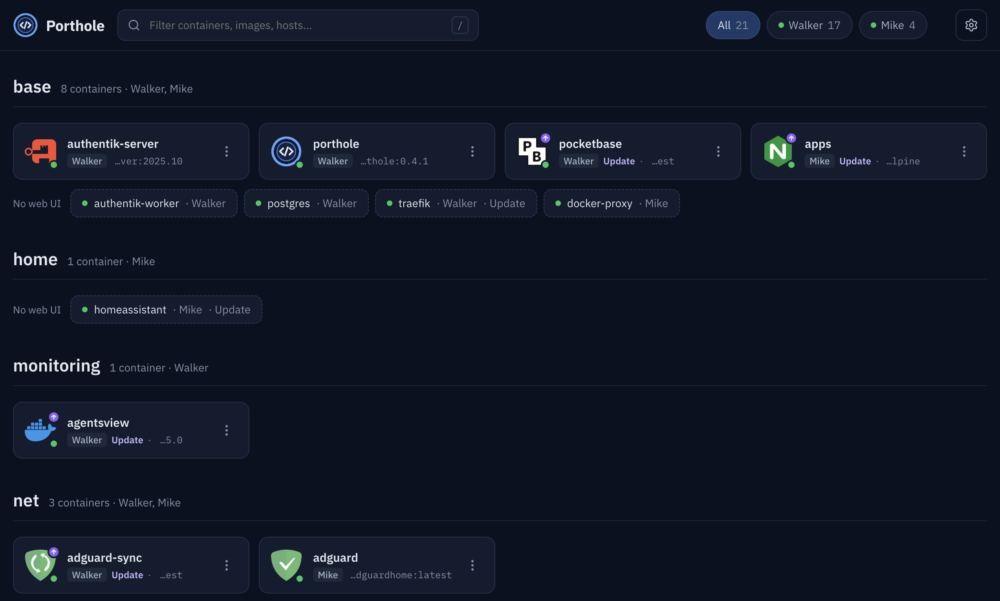

# Porthole ⚓️


> Centralized dashboard for running Docker containers with automatic endpoint discovery.



Porthole serves as the ultimate shortcut page for your self-hosted Docker environment, automatically detecting running applications, their published ports, and Traefik URLs. It centralizes all your services into one beautiful dashboard, ensuring you never have to memorize a port number again.

It resolves container icons automatically 

## Features

- 🕵️‍♂️ **Auto-Discovery**: Lists running containers with published-port or Traefik endpoints, including services without published ports.
- 🎨 **Automated Icons**: Maps container image names to icons using [Dashboard Icons](https://github.com/homarr-labs/dashboard-icons).
- 🔄 **Update Detection**: Checks Docker Hub and public GitHub Container Registry images for newer versions and digest changes.
- 🖥️ **Multiple Docker Hosts**: Fetches configured Docker connections together and separates hosts and Compose projects in the dashboard.
- ⚙️ **Per-Container Settings**: Choose a service URL and configure update checking for each container.
- 🚦 **Status Indicators**: Shows container health with color-coded semaphore (green/yellow/red).
- 🐳 **Docker Native**: Runs as a single, lightweight Docker container.
- 🛠 **Customizable**: Override icon mappings via a simple YAML configuration.

## Service URLs

Porthole discovers full URLs from Docker published ports and literal Traefik HTTP router labels. Clicking a tile prefers Traefik; when several Traefik URLs exist, a unique root route wins. Ambiguous choices open settings. A saved URL choice takes precedence and is remembered by endpoint ID.

The gear icon groups candidates under **Traefik URLs**, **Published Ports**, and any additional provider sections. Published ports use each connection’s `published-host`; single-source deployments fall back to the hostname through which you accessed Porthole when `published-host` is omitted. See [endpoint configuration and rule support](docs/CONFIGURATION.md#endpoint-discovery).

## Quick Start

Run Porthole with a single Docker command:

```bash
docker run -d \
  -p 9753:9753 \
  -v /var/run/docker.sock:/var/run/docker.sock \
  --name porthole \
  ghcr.io/room-elephant/porthole:latest
```

**Note**: The default source requires mounting `/var/run/docker.sock`. To use other or multiple already-reachable Docker endpoints, configure a [connection list](docs/CONFIGURATION.md#docker-connections).

Open [http://localhost:9753](http://localhost:9753) to view your dashboard.

## Configuration

**Custom Icons**: Create an `icons.yml` file to map container images to [Dashboard Icons](https://github.com/homarr-labs/dashboard-icons) slugs:

```yaml
my-custom-app: react
postgres: postgresql
```

Mount the entire config directory or individual files:

```bash
docker run -d -p 9753:9753 \
  -v /var/run/docker.sock:/var/run/docker.sock \
  -v $(pwd)/config:/app/config \
  --name porthole \
  ghcr.io/room-elephant/porthole:latest
```

See [Configuration Guide](docs/CONFIGURATION.md) for all options.

## Documentation

| Guide | Description |
|-------|-------------|
| [Configuration](docs/CONFIGURATION.md) | Customize icons, Docker host, registry settings, and more |
| [Development](docs/DEVELOPMENT.md) | Build from source, run tests, and contribute |

## License

MIT
